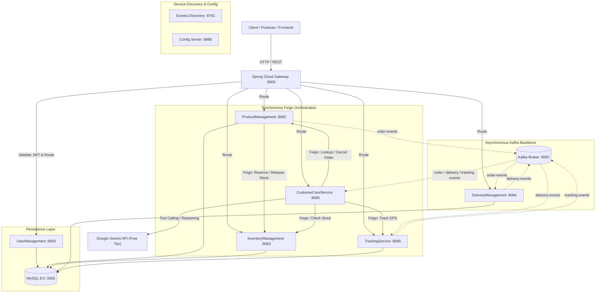

# E-Commerce + Delivery + Agentic AI Customer Care Platform

[](https://github.com/ARAVINDRASAKATLA/agentic-ecommerce-platform/actions)


-black?logo=apachekafka)


A production-grade, distributed microservices ecosystem designed to handle end-to-end commerce operations—spanning **user authentication, catalog management, transactional inventory reservations, automated delivery fleet dispatching, real-time GPS tracking, and an autonomous Agentic AI Customer Care Assistant powered by Google Gemini Tool Calling**.

---

## 🏛️ System Architecture



---

## 🚀 Microservices Portfolio

| Service | Port | Java | Key Responsibilities |
| :--- | :---: | :---: | :--- |
| **APIGateway** | `9500` | 17 | Edge routing, reactive rate limiting, and JWT authentication filter. |
| **EurekaService** | `8761` | 17 | Centralized service registry with automatic heartbeats and health tracking. |
| **ConfigServer** | `8888` | 17 | Central configuration repository with optional fallback. |
| **UserManagement** | `9000` | 21 | User onboarding, BCrypt password hashing, and role-based JWT issuance. |
| **ProductManagement** | `8082` | 21 | Product catalog, order processing, and transactional stock coordination. |
| **InventoryManagement**| `8083` | 21 | Real-time inventory tracking, atomic stock reservation, and replenishment. |
| **DeliveryManagement** | `8084` | 21 | Delivery lifecycle management, fleet tracking, and automated driver dispatch. |
| **TrackingService** | `8085` | 21 | GPS breadcrumbs, driver status tracking, and delivery location history. |
| **CustomerCareService**| `8086` | 21 | **Autonomous Agentic AI** chatbot with Google Gemini Function Calling & memory. |

---

## 🤖 Agentic AI Customer Care (`CustomerCareService`)

The customer care assistant operates as an **autonomous agent** rather than a simple static bot:

- **Multi-Turn Contextual Memory**: Remembers dialogue turns per session across sessions using `ChatMemoryService`.
- **Gemini Autonomous Tool Calling Loop**: Gemini evaluates user inquiries, chooses appropriate tools, invokes microservice endpoints via OpenFeign, evaluates the results, and synthesizes answers.
- **Declared Tools**:
  1. `lookupOrder(orderId)`: Retrieves real-time order status and item totals.
  2. `trackOrder(orderId)`: Fetches current delivery coordinates and assigned driver.
  3. `searchProducts(query)`: Searches the live product catalog.
  4. `checkProductStock(productId)`: Queries current warehouse stock level.
  5. `cancelOrder(orderId, confirmed)`: Cancels orders and restores inventory.
- **Destructive Operation Guard**: Order cancellation requires explicit customer confirmation (`confirmed: true`); otherwise, the agent prompts the user to confirm before taking action.
- **Platform Event Streaming**: Ingests `order-events`, `delivery-events`, and `tracking-events` into an in-memory ring buffer exposed via `GET /care/events`.

---

## ⚡ Asynchronous Event Flows (Kafka)

1. **`order-events`**:
   - `ORDER_CONFIRMED`: Published by `ProductManagement` when an order is created. `DeliveryManagement` automatically provisions a delivery record.
   - `ORDER_CANCELLED`: Published when an order is cancelled, initiating inventory rollback.
2. **`delivery-events`**:
   - `DELIVERY_ASSIGNED`: Published when a driver is assigned. `TrackingService` initializes tracking records.
   - `STATUS_UPDATED` & `DELIVERED`: Broadcast delivery progression.
3. **`tracking-events`**:
   - `LOCATION_UPDATED`: Broadcasts driver GPS updates for live consumer feeds.

---

## 🛠️ Tech Stack & Key Libraries

- **Language & Runtime**: Java 17 (Gateway, Eureka, Config) & Java 21 (Domain services).
- **Frameworks**: Spring Boot 3.5.3, Spring Cloud 2025.0.3, Spring Cloud Gateway (WebFlux), Spring Cloud OpenFeign.
- **Security**: Spring Security, JWT (`jjwt 0.12.6`), BCrypt.
- **Event Streaming**: Apache Kafka (KRaft mode), Spring Kafka.
- **AI / LLM Integration**: Google Gemini REST API (`gemini-flash-latest`), Spring RestClient with declarative Function Calling.
- **Database & ORM**: MySQL 8.0, Spring Data JPA, Hibernate.
- **Containerization & CI/CD**: Docker, Docker Compose, GitHub Actions.

---

## 🐳 Running with Docker Compose

Ensure Docker Desktop or Docker Engine is running:

```bash
# 1. Clone the repository
git clone https://github.com/ARAVINDRASAKATLA/agentic-ecommerce-platform.git
cd agentic-ecommerce-platform

# 2. Build and run all 11 containers in the background
docker compose up --build -d

# 3. Verify container health
docker compose ps
```

### Accessing Services

- **API Gateway**: `http://localhost:9500`
- **Eureka Dashboard**: `http://localhost:8761`
- **Customer Care Agent API**: `http://localhost:9500/care/chat`
- **Kafka Broker**: `localhost:9092`
- **MySQL Database**: `localhost:3306`

---

## 💻 Running Locally (Without Docker)

### Prerequisites
- JDK 17 & JDK 21 installed
- MySQL running on `localhost:3306` with user `root`, password `root`
- Optional: Kafka running on `localhost:9092` (all services have offline fallback resilience)

### Startup Sequence
Run each service in a separate terminal:
```bash
# 1. Service Discovery
cd EurekaService && ./mvnw spring-boot:run

# 2. Configuration Server (Optional)
cd ConfigServer && ./mvnw spring-boot:run

# 3. Domain Microservices
cd UserManagement && ./mvnw spring-boot:run
cd InventoryManagement && ./mvnw spring-boot:run
cd ProductManagement && ./mvnw spring-boot:run
cd DeliveryManagement && ./mvnw spring-boot:run
cd TrackingService && ./mvnw spring-boot:run
cd CustomerCareService && ./mvnw spring-boot:run

# 4. Edge API Gateway
cd APIGateway && ./mvnw spring-boot:run
```

---

## 🧪 End-to-End Postman & cURL Walkthrough

### 1. Register & Login (UserManagement)
```bash
curl -X POST http://localhost:9500/users/login \
  -H "Content-Type: application/json" \
  -d '{
    "username": "alex",
    "password": "Password@123"
  }'
```
*Save the returned `token` as `Bearer <JWT_TOKEN>` for subsequent requests.*

### 2. Stock Inventory (InventoryManagement)
```bash
curl -X POST http://localhost:9500/inventory \
  -H "Authorization: Bearer <JWT_TOKEN>" \
  -H "Content-Type: application/json" \
  -d '{
    "productId": 1,
    "totalStock": 50
  }'
```

### 3. Place Order (ProductManagement)
```bash
curl -X POST http://localhost:9500/orders/add \
  -H "Authorization: Bearer <JWT_TOKEN>" \
  -H "Content-Type: application/json" \
  -d '{
    "userId": 1,
    "totalAmount": 1200.0,
    "orderItems": [
      {
        "productId": 1,
        "quantity": 2,
        "price": 600.0
      }
    ]
  }'
```

### 4. Chat with Autonomous Gemini Customer Care Agent
```bash
curl -X POST http://localhost:9500/care/chat \
  -H "Authorization: Bearer <JWT_TOKEN>" \
  -H "Content-Type: application/json" \
  -d '{
    "sessionId": "session-101",
    "message": "Where is my order 1 right now?"
  }'
```
*The agent autonomously executes `trackOrder(orderId=1)` and returns the assigned driver and GPS location status.*

### 5. Stream Real-Time Microservice Events
```bash
curl -X GET "http://localhost:9500/care/events?orderId=1" \
  -H "Authorization: Bearer <JWT_TOKEN>"
```

---

## 🎯 Key Interview Talking Points

1. **Dual Communication Paradigm**:
   - *Synchronous (OpenFeign)*: Used for transactional consistency where immediate success/failure is mandatory (e.g., reserving inventory during order creation).
   - *Asynchronous (Kafka)*: Used for eventual consistency and decoupled downstream workflows (e.g., driver dispatch, GPS breadcrumbs, customer care timeline).
2. **Edge Security Architecture**:
   - Gateway validates HMAC-SHA256 JWT tokens at the perimeter, verifies expiration, and injects authenticated identity headers (`X-User-Id`, `X-Username`, `X-User-Role`) for downstream microservices.
3. **Agentic Tool Calling with Guardrails**:
   - Gemini LLM is granted declarative tools with schema validation. Destructive operations (order cancellation) cannot be executed without client-side confirmation flags.
4. **Resilience & Fault Tolerance**:
   - `CompletableFuture` non-blocking Kafka publishing prevents broker outages from degrading synchronous order endpoints.
   - Circuit-friendly fallback enables microservices to function locally even when external infrastructure components are initializing.

---

## 📄 License
This project is licensed under the MIT License.
